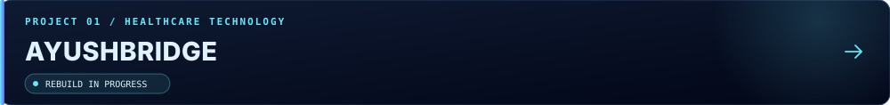
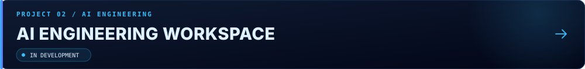
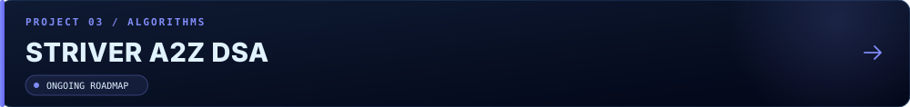

<div align="center">



<a href="https://srujan-ranganath-portfolio.ai.studio/"></a>
<a href="https://www.linkedin.com/in/srujan-ranganath-46353130a/"></a>
<a href="https://github.com/SrujanRanganath?tab=repositories"></a>
<a href="https://leetcode.com/u/YBX7MZ2P1V/"></a>

</div>


```text
srujan@engineering:~$ cat profile.txt

name       Srujan Ranganath
focus      AI Engineering | Software Development | Data Science
degree     B.E. Computer Science & Engineering (VTU)
           Rajeev Institute of Technology, Hassan
degree     BS Data Science, IIT Madras
direction  Design, build and deploy complete AI-powered products
```

`Artificial Intelligence` `LLM applications` `Multi-agent systems` `Machine learning` `Full-stack development` `Backend engineering` `Data science` `Data structures & algorithms` `Software architecture`




**Healthcare interoperability platform** connecting AYUSH terminology (NAMASTE codes) with ICD-11 and FHIR-style clinical bundles. Being rebuilt module by module with a production-first approach.

- Authenticated REST API with JWT, Zod request validation, rate limiting and Helmet
- Terminology search across NAMASTE records using MongoDB text indexes
- NAMASTE to ICD-11 mapping with cached results
- Ayurvedic enrichment lookup per condition
- FHIR Bundle generation (Patient, Condition, Provenance) and a dashboard
- React client for search, mapping and bundle viewing

`TypeScript` `Node.js` `Express` `MongoDB` `Mongoose` `React` `Vite` `Tailwind CSS` `TanStack Query`

<a href="https://github.com/SrujanRanganath/ayushbridge"></a>



**AI-assisted software development workspace** that brings multiple generation workflows into one engineering product, with a frontend, backend services and LLM integrations.

- Scope: website generation, code generation, document generation and data cleaning
- Scope: project generation and management with backend AI services
- Status: in development, planned capabilities are not all complete yet

`React` `TypeScript` `Python` `FastAPI` `PostgreSQL` `LLM APIs`

<a href="https://github.com/SrujanRanganath/AI-engineering-workspace"></a>



**C++ problem-solving repository** following Striver's A2Z roadmap, with LeetCode solutions synced alongside the roadmap work.

- C++ fundamentals: control flow, functions, arrays, strings, references
- LeetCode solutions with per-problem notes across arrays, strings, linked lists, math and hashing
- Roadmap structure for sorting, binary search, recursion, stacks and queues, trees, graphs and dynamic programming

`C++` `Data Structures` `Algorithms`

<a href="https://github.com/SrujanRanganath/Striver-DSA"></a>


<div align="center">

**Primary language: C++** &nbsp;|&nbsp; **Roadmap: Striver A2Z** &nbsp;|&nbsp; **Platform: LeetCode**

<a href="https://leetcode.com/u/YBX7MZ2P1V/"></a>

<a href="https://leetcode.com/u/YBX7MZ2P1V/"></a>

</div>


<table>
<tr>
<td width="22%" valign="top"><b>Applied in projects</b><br><sub>used in the repositories above</sub></td>
<td valign="top"></td>
</tr>
<tr>
<td valign="top"><b>Working knowledge</b><br><sub>languages, data and tooling</sub></td>
<td valign="top"><br><code>Power BI</code> <code>Render</code></td>
</tr>
<tr>
<td valign="top"><b>AI tooling</b><br><sub>APIs and developer tools</sub></td>
<td valign="top"><code>OpenAI API</code> <code>Google Gemini API</code> <code>LangChain</code> <code>Ollama</code> <code>Streamlit</code> <code>Claude</code> <code>Cursor</code></td>
</tr>
<tr>
<td valign="top"><b>Exploring</b><br><sub>current learning direction</sub></td>
<td valign="top"><code>LLM-powered applications</code> <code>Multi-agent systems</code> <code>System design</code> <code>Scalable backend architecture</code></td>
</tr>
</table>


<div align="center">

<picture>
  <source media="(prefers-color-scheme: dark)" srcset="https://raw.githubusercontent.com/SrujanRanganath/SrujanRanganath/output/github-contribution-grid-snake-dark.svg">
  <source media="(prefers-color-scheme: light)" srcset="https://raw.githubusercontent.com/SrujanRanganath/SrujanRanganath/output/github-contribution-grid-snake.svg">
  
</picture>

<a href="https://github.com/SrujanRanganath?tab=repositories"></a>

</div>


